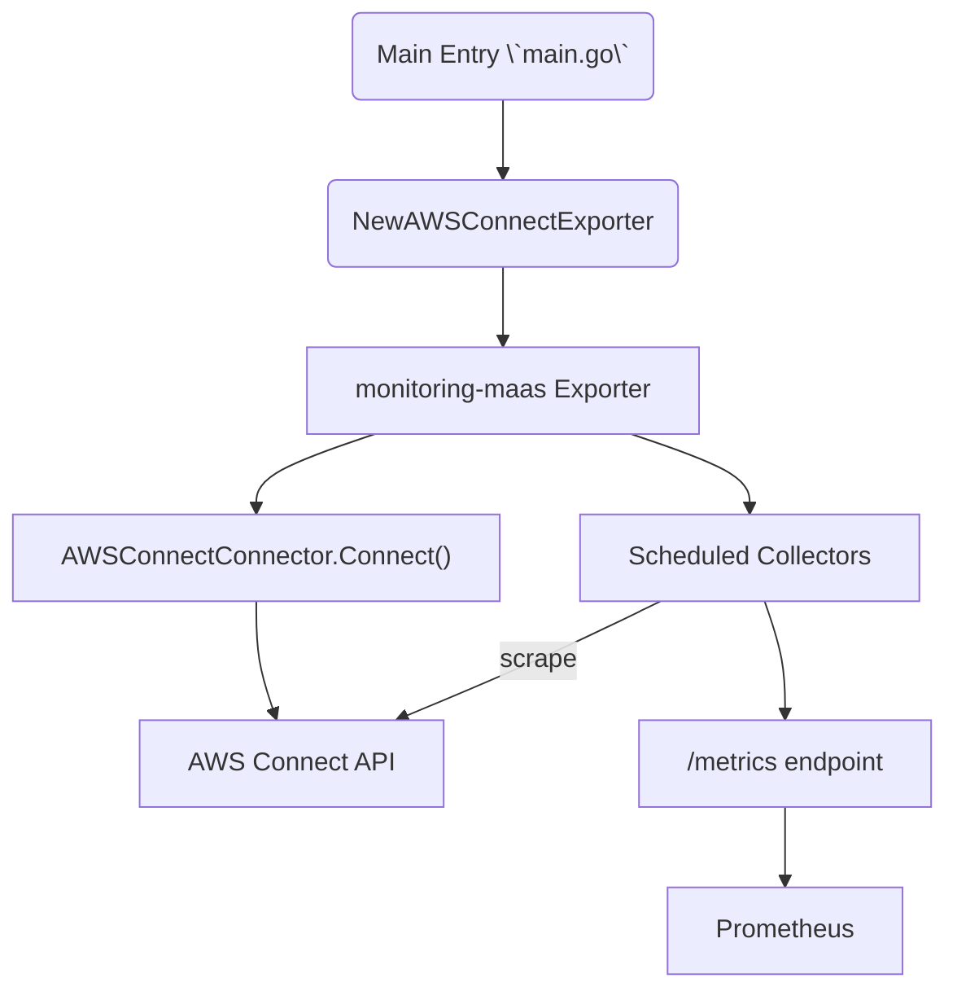

# AWS Connect Exporter - Developer Documentation

This document contains comprehensive development guidance based on the migration from a standalone exporter to the maas framework. It covers architecture decisions, common pitfalls, debugging techniques, and best practices learned during the development process.

## Table of Contents

- [Architecture Overview](#architecture-overview)
- [Development Environment Setup](#development-environment-setup)
- [Framework Integration Patterns](#framework-integration-patterns)
- [Configuration Management](#configuration-management)
- [Common Development Pitfalls](#common-development-pitfalls)
- [Debugging Guide](#debugging-guide)
- [Testing Strategies](#testing-strategies)
- [Deployment Considerations](#deployment-considerations)

## Architecture Overview

### Framework Constraints

The **monitoring-maas framework is stable and should NOT be modified**. It has been unchanged for 3 years and is used by 30+ exporters. All development must work within the existing framework constraints.

### Component Structure

```
connect-exporter/
├── cmd/connect-exporter_exporter/main.go    # Entry point
├── connectors/
│   ├── aws_connect_connector.go              # AWS Connect API abstraction
│   └── mock.go                               # Test connector
├── collectors/
│   ├── aws_connect_exporter.go               # Main exporter constructor
│   ├── generic_realtime_collector.go         # Configurable realtime metrics
│   └── generic_historical_collector.go       # Configurable historical metrics
├── config.development.yml                    # Development configuration
├── config.aws-connect.yml                    # Production configuration
└── monitoring-maas/                          # Framework (DO NOT MODIFY)
```

### Exporter Flow Diagram

The exporter relies on the **monitoring-maas** framework to handle common
functionality such as configuration parsing, scheduling collectors and exposing
the `/metrics` endpoint. The following diagram shows the high level flow from
application start to metrics being available for Prometheus:




### Key Design Patterns

1. **Connector Pattern**: All external API interactions go through connectors implementing `maas.Connector`
2. **Collector Pattern**: Metrics collection using `maas.ScheduledScraper` with batch processing
3. **Configuration Pattern**: YAML + CLI flags with environment-specific overrides

## Development Environment Setup

### Prerequisites

```bash
# Required dependencies
go mod tidy

# For mock API development
cd docs/tools/aws-mock-api-main
npm install express body-parser
```

### Development Mode Configuration

Set environment variable to enable development mode:

```bash
export ENV=development
```

This enables:
- Mock API endpoint usage (defaults to http://localhost:3000)
- Connection validation skip
- Enhanced debug logging
- Faster collection intervals

### Running the Exporter

```bash
# Minimal command (all required flags)
./aws-connect-exporter \
  --web.listen-port=9090 \
  --labels.fqdn=localhost \
  --labels.location=dev \
  --labels.country=UK \
  --labels.ip-address=127.0.0.1 \
  --config.file=config.development.yml \
  --no-advertise

# With debug logging
./aws-connect-exporter \
  --web.listen-port=9090 \
  --labels.fqdn=localhost \
  --labels.location=dev \
  --labels.country=UK \
  --labels.ip-address=127.0.0.1 \
  --config.file=config.development.yml \
  --no-advertise \
  --log.level=debug
```

### Mock API Server

```bash
cd docs/tools/aws-mock-api-main
node server.js
```

Provides endpoints that simulate AWS Connect API responses for cost-free development.

## Framework Integration Patterns

### Exporter Constructor Pattern

The maas framework requires a specific constructor pattern:

```go
func NewAWSConnectExporter(options ...func(*maas.Exporter)) (*maas.Exporter, error) {
    app := kingpin.New("aws-connect-exporter", "Description").DefaultEnvars()
    
    // Create connector with flag configuration
    connector, err := connectors.NewConfigurableAWSConnectConnector(app)
    if err != nil {
        return nil, err
    }
    
    // Create collectors
    scrapers := []*maas.ScheduledScraper{
        NewRealtimeQueueCollector(app, defaultConfig),
        NewAgentStatusCollector(app, defaultConfig),
    }
    
    // Create exporter with framework
    options = append(options, maas.WithScheduledScrapers(scrapers...))
    return maas.NewExporter(app, connector, options...)
}
```

### Configuration Parsing Timing

**Critical**: Configuration parsing must happen during `Connect()`, not during constructor:

```go
// ❌ WRONG - Flags not parsed yet during constructor
func NewConnector() {
    if *flagValue != "" {  // flagValue is empty!
        // This won't work
    }
}

// ✅ CORRECT - Parse during Connect() after framework parses flags
func (c *Connector) Connect() error {
    if !c.configured {
        err := c.configure()  // Parse config here
        if err != nil {
            return err
        }
    }
    // Test connection
    return c.testConnection()
}
```

### Collector Scheduling Pattern

```go
func NewCollector(app *kingpin.Application, config Config) *maas.ScheduledScraper {
    interval := time.Duration(config.Interval) * time.Second
    timeout := 30 * time.Second
    
    return maas.NewScheduledScraper("collector_name", NewScraper(app, config),
        maas.WithSchedule(maas.NewSchedule(
            maas.WithFrequency(interval),
            maas.WithTimeout(timeout),
        )),
        maas.WithDescription(app, "metric_name", "Description", []string{"label1", "label2"}),
    )
}
```

## Configuration Management

### Configuration Structure

```go
type AWSConnectConfig struct {
    AWS AWSConfig `yaml:"aws"`
    Collectors CollectorsConfig `yaml:"collectors"`
}

type AWSConfig struct {
    Region      string `yaml:"region"`
    InstanceARN string `yaml:"instance_arn"`
}
```

### Flag Definition Pattern

```go
func NewConfigurableConnector(app *kingpin.Application) (*Connector, error) {
    connector := &Connector{}
    
    // Define flags that will be parsed later
    connector.instanceARNFlag = app.Flag("instance-arn", "AWS Connect Instance ARN").String()
    connector.regionFlag = app.Flag("region", "AWS region").Default("us-east-1").String()
    connector.configFileFlag = app.Flag("config.file", "Config file path").Default("config.yml").String()
    
    return connector, nil
}
```

### Configuration Loading Pattern

```go
func (c *Connector) configure() error {
    // Load YAML config
    var cfg AWSConnectConfig
    configPath := *c.configFileFlag
    
    if _, err := os.Stat(configPath); err == nil {
        yamlFile, err := os.ReadFile(configPath)
        if err == nil {
            yaml.Unmarshal(yamlFile, &cfg)
        }
    }
    
    // CLI flags override config file
    if *c.instanceARNFlag != "" {
        cfg.AWS.InstanceARN = *c.instanceARNFlag
    }
    
    // Validate required fields
    if cfg.AWS.InstanceARN == "" {
        return fmt.Errorf("AWS Connect Instance ARN is required")
    }
    
    // Apply configuration
    c.region = cfg.AWS.Region
    c.instanceARN = cfg.AWS.InstanceARN
    c.configured = true
    
    return nil
}
```

## Common Development Pitfalls

### 1. "unexpected false" Error

**Symptom**: `time="..." level=fatal msg="unexpected false"`

**Cause**: Missing required CLI flags or incorrect flag format

**Solution**: 
- Ensure all required flags are provided: `--labels.fqdn`, `--labels.location`, `--labels.country`, `--labels.ip-address`, `--web.listen-port`
- Use correct flag format: `--no-advertise` instead of `--advertise=false`
- Check help output: `./exporter --help`

### 2. Configuration Parsed Too Early

**Symptom**: Fatal error about missing configuration during startup

**Cause**: Trying to access flag values during constructor before framework parsing

**Solution**: Move all configuration parsing to `Connect()` method

### 3. AWS SDK Field Compatibility

**Symptom**: Compilation errors about missing fields (e.g., `DisplayOrder`)

**Cause**: AWS SDK version differences between original code and current version

**Solution**: Check AWS SDK documentation for current field availability, remove or replace missing fields

### 4. Import Dependencies

**Symptom**: `imported and not used` compilation errors

**Cause**: Refactoring leaves unused imports

**Solution**: Remove unused imports, use `go mod tidy` regularly

### 5. Template Framework Conflicts

**Symptom**: Compilation errors in monitoring-maas template files

**Cause**: Template files from exporter generation that don't compile with current setup

**Solution**: Backup and ignore problematic template files - focus on AWS Connect implementation

## Debugging Guide

### Log Analysis

Enable debug logging:
```bash
--log.level=debug
```

Key log patterns to look for:

1. **Configuration Loading**:
```json
{"config_file":"config.development.yml","instance_arn":"arn:aws:connect:...","level":"info","msg":"Starting AWS Connect exporter"}
```

2. **Development Mode Detection**:
```json
{"level":"info","msg":"Running in development mode with mock AWS Connect API","mock_endpoint":"http://localhost:3000"}
```

3. **Collector Scheduling**:
```json
{"level":"info","msg":"scheduled realtime_queue with ID: 1 every 30s"}
{"level":"info","msg":"scheduled agent_status with ID: 2 every 1m0s"}
```

4. **Collection Attempts**:
```json
{"collector_version":"1.0.0","level":"debug","msg":"Starting realtime queue metrics collection"}
```

5. **API Failures** (expected in development without mock API):
```json
{"level":"warning","msg":"realtime_queue: scrape failed: failed to list queues: ... connection refused"}
```

### Metrics Debugging

Check metrics endpoint:
```bash
curl http://localhost:9090/metrics | grep -E "(aws|connect|queue|agent|maas_scrape)"
```

Key metrics to monitor:
- `maas_scrape_total` - Total scrape attempts
- `maas_scrape_failed_total` - Failed scrapes (expected without mock API)
- `maas_scrape_frequency_seconds` - Configured intervals
- `maas_scrape_duration_*` - Performance metrics

### Connection Testing

Test individual components:
```bash
# Health check
curl http://localhost:9090/health  # Should return "PONG"

# Mock API (if running)
curl http://localhost:3000/health

# Process status
ps aux | grep aws-connect-exporter
```

## Testing Strategies

### Unit Testing

Create mock connectors for unit tests:
```go
func TestCollector(t *testing.T) {
    mockConnector := connectors.NewMockConnector()
    mockConnector.AddResponse("list_queues", `{"queues": [...]}`)
    
    collector := NewCollector(app, config)
    metrics, err := collector.Scrape(mockConnector)
    
    assert.NoError(t, err)
    assert.Len(t, metrics, expectedCount)
}
```

### Integration Testing

1. **Development Mode**: Use mock API server for realistic testing
2. **Staging**: Use AWS Connect staging instance with minimal data
3. **Production**: Monitor real metrics and performance

### Performance Testing

Monitor key metrics:
- Collection duration (should be < 30 seconds)
- Memory usage (check for leaks)
- API rate limiting compliance
- Error rates and retry behavior

## Deployment Considerations

### Production Configuration

```yaml
# config.aws-connect.yml
aws:
  region: "us-east-1"
  instance_arn: "arn:aws:connect:us-east-1:ACCOUNT:instance/INSTANCE-ID"

collectors:
  realtime_queue:
    enabled: true
    interval: 60  # 1 minute for production
    
  agent_status:
    enabled: true
    interval: 300  # 5 minutes for production
```

### IAM Permissions

Required AWS permissions:
```json
{
    "Version": "2012-10-17",
    "Statement": [
        {
            "Effect": "Allow",
            "Action": [
                "connect:ListQueues",
                "connect:GetCurrentMetricData",
                "connect:GetMetricDataV2",
                "connect:ListAgentStatuses"
            ],
            "Resource": "arn:aws:connect:REGION:ACCOUNT:instance/INSTANCE-ID"
        }
    ]
}
```

### Service Registration

For production environments with Consul:
```bash
./aws-connect-exporter \
  --web.listen-port=9090 \
  --labels.fqdn=hostname.domain.com \
  --labels.location=datacenter \
  --labels.country=US \
  --labels.ip-address=10.0.1.100 \
  --config.file=config.aws-connect.yml
  # --advertise defaults to true for Consul registration
```

For development or non-Consul environments:
```bash
./aws-connect-exporter \
  --no-advertise \
  [other flags...]
```

### Monitoring and Alerting

Key metrics to alert on:
- `maas_scrape_failed_total` - High failure rates
- `maas_scrape_timeout_total` - Collection timeouts
- `maas_scrape_duration` - Performance degradation
- Absence of expected AWS Connect metrics

### Scaling Considerations

- AWS Connect API has rate limits (typically 2 TPS per API)
- Use batch processing for large numbers of queues/agents
- Implement exponential backoff for retries
- Monitor AWS API throttling responses

## Framework Migration Lessons

### Key Success Factors

1. **Understand Framework Constraints**: Don't modify the stable framework
2. **Respect Timing**: Configuration parsing must happen at the right time
3. **Use Framework Patterns**: Follow established connector/collector patterns
4. **Test Incrementally**: Build, test, debug in small steps
5. **Comprehensive Logging**: Essential for debugging complex integrations

### Migration Strategy

1. **Analyze Original Code**: Understand metrics, API calls, and business logic
2. **Create Framework Structure**: Set up connectors and collectors
3. **Migrate Configuration**: Move to YAML + CLI flags pattern
4. **Implement Collectors**: Port metric collection logic
5. **Add Development Mode**: Enable mock API for cost-free development
6. **Test and Debug**: Validate with real and mock APIs
7. **Document Learnings**: Create comprehensive developer documentation

This documentation should significantly reduce development time for future exporter implementations and provide clear guidance for maintaining and extending the AWS Connect exporter.